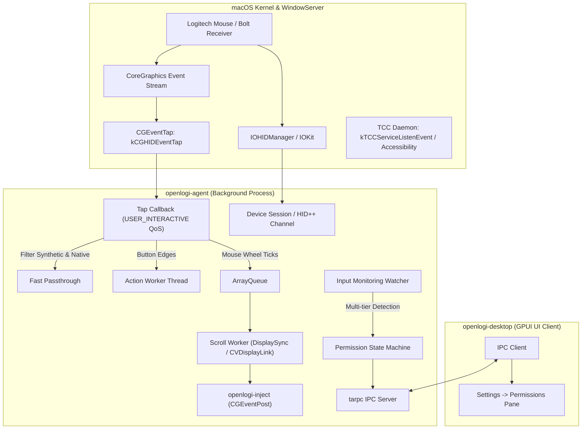

# Implementation Plan: OpenLogi Fork 0.8.3 — macOS Input Monitoring Reliability & Input Pipeline Performance Optimisation

## Goal Description

Resolve two critical issues in the OpenLogi macOS fork (v0.8.3):
1. **Unreliable macOS Input Monitoring Permission Detection:** Even when granted under System Settings → Privacy & Security → Input Monitoring, OpenLogi frequently reports the permission as denied or unavailable. We must establish reliable multi-tier detection (`CGPreflightListenEventAccess`, `IOHIDCheckAccess`, and live capability probing), fix bundle code signing and responsible process attribution, introduce a rich permission lifecycle state machine, and provide graceful restart/recheck mechanisms.
2. **Input Pipeline Performance Optimisation (Scroll & Mouse):** Eliminate unnecessary latency, thread contention, and transient memory allocations in the critical input path. This includes removing redundant `MouseMoved` event interception, eliminating per-event `String` allocations during IOKit device lookup, switching scroll preferences to wait-free atomic snapshots, eliminating global quantizer mutex contention, and introducing non-intrusive `mach_absolute_time` latency diagnostics.

---

## User Review Required

> [!IMPORTANT]
> **1. Removal of `CGEventType::MouseMoved` from Active Event Tap:**
> Gesture button hold-and-swipe detection only operates while a mouse button (e.g. Middle, Back, Forward) is held down, which macOS reports as `LeftMouseDragged`, `RightMouseDragged`, or `OtherMouseDragged`. Plain cursor motion generates `MouseMoved` with zero buttons pressed. Hooking `MouseMoved` at `kCGHIDEventTap` forces every single pointer motion at 1000 Hz through the OpenLogi callback thread. We propose removing `MouseMoved` from `hooked_event_types()` while preserving all `*Dragged` events. This provides zero-overhead native pointer movement without impacting gestures.
>
> **2. Code Signing Identity and Designated Requirement Verification:**
> Ad-hoc linker-signed binaries (`flags=0x20002(adhoc,linker-signed)`) with `Info.plist=not bound` and unsealed resources fail `codesign --verify --strict`. When this happens, macOS TCC marks the signature as invalid and fails code requirement matching. The bundling scripts will be updated to ensure consistent code signing with an explicit bundle identifier (`org.openlogi.agent`) and sealed resources across both development bundles and release packaging.
>
> **3. Extended Permission States in IPC Protocol:**
> We will upgrade the internal permission state to represent the full lifecycle: `Granted`, `Denied`, `NotYetRequested`, `RequestPending`, `RequiresRestart`, and `Unavailable`. To maintain strict append-only IPC wire compatibility (per `.claude/rules/ipc-protocol.md`), the existing boolean fields (`input_monitoring_granted`, `hid_open_failures`) remain intact, with extended state optionally carried or derived for the UI.

---

## Architecture & Subsystem Mapping



---

## Proposed Changes

### Component 1: macOS Permission Detection & Management (`openlogi-permissions`, `openlogi-hid`, `openlogi-agent`)

#### [MODIFY] `crates/openlogi-permissions/src/lib.rs`
- Expand `PermissionStatus` with explicit lifecycle states:
  ```rust
  #[derive(Clone, Copy, PartialEq, Eq, Debug)]
  pub enum PermissionStatus {
      Granted,
      Denied,
      NotYetRequested,
      RequestPending,
      RequiresRestart,
      Unavailable,
  }
  ```
- Ensure backward compatibility helper methods (e.g. `is_granted()`, `needs_restart()`).

#### [MODIFY] `crates/openlogi-permissions/src/macos.rs`
- Upgrade `input_monitoring()` to use multi-tier detection:
  1. Call `CGPreflightListenEventAccess()` (CoreGraphics public API).
  2. Call `IOHIDCheckAccess(IOHIDRequestType::ListenEvent)` (IOKit public API).
  3. If TCC records indicate access is granted or `IOHIDCheckAccess` returned granted, but HID open previously failed with permission-session staleness, return `PermissionStatus::RequiresRestart`.
  4. If both report not granted, distinguish between `Denied` and `NotYetRequested` using `IOHIDCheckAccess` status (`kIOHIDAccessTypeUnknown` vs `kIOHIDAccessTypeDenied`).

#### [MODIFY] `crates/openlogi-hid/src/permissions.rs`
- Implement hybrid check in `has_access()`:
  ```rust
  pub(super) fn has_access() -> bool {
      unsafe {
          objc2_core_graphics::CGPreflightListenEventAccess()
      } || matches!(
          objc2_io_kit::IOHIDCheckAccess(objc2_io_kit::IOHIDRequestType::ListenEvent),
          objc2_io_kit::IOHIDAccessType::Granted
      )
  }
  ```
- Add `request_access()` using `CGRequestListenEventAccess()` and `IOHIDRequestAccess(IOHIDRequestType::ListenEvent)`.
- Support detection of whether an app restart is required to refresh the process TCC credential table.

#### [MODIFY] `crates/openlogi-agent-core/src/watchers/input_monitoring.rs`
- Augment polling watcher to check both `has_access()` and detect permission transitions.
- Hook into workspace wake/sleep and active window change to immediately re-poll when returning from System Settings.

#### [MODIFY] `crates/openlogi-agent/src/main.rs` & `binary_watch/relaunch.rs`
- Allow graceful agent restart triggering when a transition from Denied/RequiresRestart to Granted is observed.
- Support manual re-check trigger via IPC so clicking "Refresh" or returning from System Settings immediately resolves the state.

#### [MODIFY] `xtask/src/commands/macos/dev_bundle/signing.rs` & `bundle/signing.rs`
- Ensure helper bundle `OpenLogi Agent.app` is codesigned with valid sealed resources (`--force --sign - --timestamp=none`) so `codesign --verify --strict` passes and `Info.plist` is bound, preventing TCC signature invalidation.

---

### Component 2: Event Tap & Mouse Input Optimization (`openlogi-hook`)

#### [MODIFY] `crates/openlogi-hook/src/macos.rs`
- **Remove `CGEventType::MouseMoved` from `hooked_event_types()`:**
  - Retain `LeftMouseDragged`, `RightMouseDragged`, `OtherMouseDragged` for gesture hold-and-swipe.
  - This eliminates event tap wakeups for unheld pointer motion (at 1000+ Hz), saving CPU cycles and reducing motion latency to zero.
- **Eliminate Per-Event String Allocation in `sender_device_info`:**
  - Update `SenderDeviceInfo` to precompute device flags:
    ```rust
    #[derive(Clone, Copy, Default)]
    struct CachedSenderInfo {
        vendor_id: Option<u32>,
        product_id: Option<u32>,
        is_trackpad: bool,
        is_logitech: bool,
    }
    ```
  - Store cached device info using integer identifiers without allocating heap `String`s on every scroll or button event.
  - Update `event_sender_id` and cache retrieval to use zero allocations on cache hit.
- **Fast-Path Synthetic Event Filtering:**
  - Optimize the synthetic event check to check the integer user data field with minimal overhead before any translation allocations.

---

### Component 3: Scroll Pipeline Optimization (`openlogi-agent-core`, `openlogi-inject`)

#### [MODIFY] `crates/openlogi-agent-core/src/runtime/scroll/worker.rs`
- Replace `std::sync::RwLock<ScrollPreferenceSnapshot>` with `arc_swap::ArcSwap<ScrollPreferenceSnapshot>` in `ScrollPreferences`.
- `load()` becomes an atomic load of an `Arc`, eliminating reader lock acquisition and atomic count churning in `try_hook_scroll`.
- Cache precomputed multipliers and CurvePresets directly in the snapshot.

#### [MODIFY] `crates/openlogi-inject/src/inject/macos.rs`
- Eliminate global mutex contention in scroll quantizers (`LINE_SCROLL_QUANTIZER`, `PIXEL_SCROLL_QUANTIZER`, `SMOOTH_SCROLL_QUANTIZER`):
  - Convert quantizers to thread-local or lock-free cells since each output mode is driven sequentially by the dedicated `openlogi-scroll` worker thread.
- Avoid redundant `THREAD_EVENT_SOURCE` cloning where a reference or cached pointer suffices.

---

### Component 4: High-Resolution Latency Diagnostics & Benchmarks

#### [NEW] `crates/openlogi-agent-core/src/runtime/diagnostics.rs`
- Implement a non-intrusive latency probe using `mach_absolute_time()` / `mach_timebase_info`:
  ```rust
  pub struct InputLatencyMetrics {
      pub tap_callback_ns: u64,
      pub worker_queue_ns: u64,
      pub injection_ns: u64,
      pub total_pipeline_ns: u64,
  }
  ```
- Guard with an atomic flag (`DIAGNOSTICS_ENABLED`) or compile-time cfg so production overhead is a single predictable branch (cost < 1ns).
- Surface metrics for benchmarking and regression testing.

#### [MODIFY] `crates/openlogi-agent-core/benches/scroll_engine.rs`
- Add end-to-end benchmark measuring:
  - Raw tap callback translation throughput (events/sec).
  - Scroll impulse dispatch latency (P50, P95, P99).
  - Memory allocation count per 10,000 simulated events (verifying 0 allocations).

---

## Verification Plan

### Automated Tests
1. **Unit & Integration Tests:**
   ```sh
   cargo test -p openlogi-permissions
   cargo test -p openlogi-hook
   cargo test -p openlogi-agent-core
   cargo test -p openlogi-inject
   cargo test -p openlogi-ipc --test wire_format
   ```
2. **Criterion Latency & Throughput Benchmarks:**
   ```sh
   cargo bench -p openlogi-agent-core --bench scroll_engine
   ```
3. **Workspace-Wide Local Verification Gate:**
   ```sh
   cargo clippy -p openlogi-permissions -p openlogi-hook -p openlogi-agent-core -p openlogi-inject -p openlogi-agent --all-targets -- -D warnings
   cargo fmt --all -- --check
   ```

### Manual Verification
1. **Input Monitoring Permission Detection:**
   - Launch OpenLogi when Input Monitoring is revoked -> verify UI indicates "Not granted" and links to System Settings.
   - Grant Input Monitoring in System Settings -> verify OpenLogi detects the update and transitions to "Granted" (or triggers automatic agent restart if needed) without requiring full OS reboot.
   - Verify codesign signature integrity on built bundles using `codesign --verify --strict`.
2. **Scroll & Mouse Input Fidelity:**
   - Test discrete mouse wheel scrolling: verify accurate single-tick lines.
   - Test smooth scrolling on Logitech MX Master / mouse wheel: verify smooth deceleration without stutter.
   - Test built-in Apple Silicon trackpad scrolling & pinch-to-zoom gestures: verify trackpad events pass through completely unaltered.
   - Test gesture button hold-and-swipe (e.g. thumb/middle button swipe left/right for desktop switching): verify gestures fire reliably while cursor movement remains fluid.
