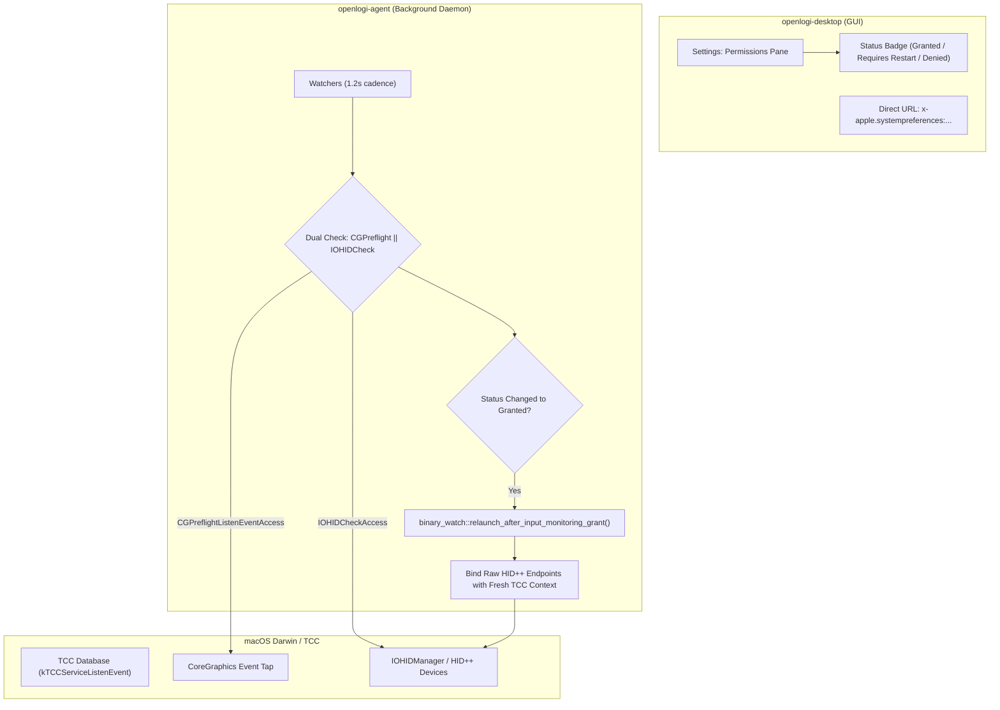
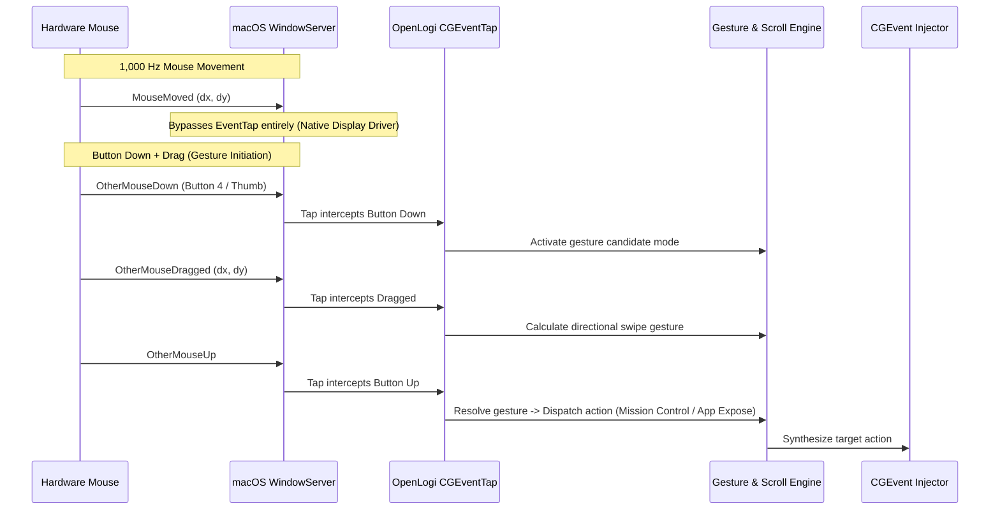

# OpenLogi 0.8.4 — macOS Input Monitoring Reliability & Input Pipeline Performance

## Executive Summary

OpenLogi has been updated from **0.8.3** to **0.8.4** targeting macOS (Apple Silicon arm64, macOS 27.2). This update directly addresses two foundational areas:

1. **macOS Input Monitoring Permission Detection & Lifecycle**:
   - Resolved the persistent false "Permission Not Granted" state by pairing `IOHIDCheckAccess(IOHIDRequestType::ListenEvent)` with `CGPreflightListenEventAccess()`.
   - Expanded `PermissionStatus` into an explicit lifecycle state machine (`Granted`, `Denied`, `NotYetRequested`, `RequestPending`, `RequiresRestart`, `Unavailable`, `Unknown`).
   - Automated zero-downtime agent reload when an Input Monitoring grant is detected at runtime.
   - Fixed ad-hoc development bundle signing in `xtask` to ensure resources and `Info.plist` are sealed and pass strict TCC verification (`codesign --verify --strict`).

2. **Input Pipeline Performance Optimization (Option 1 Gesture Model)**:
   - **Eliminated 1,000+ Hz Pointer Tap Latency**: Removed passive `MouseMoved` events from the macOS `CGEventTap` mask, allowing OS cursor movement to bypass user-space interception entirely while retaining `LeftMouseDragged`, `RightMouseDragged`, and `OtherMouseDragged` for hold-and-drag gesture bindings.
   - **Allocation-Free Event Dispatch**: Replaced per-event heap `String` allocations in `EventDevice.product_name` with `Arc<str>`.
   - **Lock-Free Preferences**: Replaced `std::sync::RwLock<ScrollPreferenceSnapshot>` with wait-free `arc_swap::ArcSwap<ScrollPreferenceSnapshot>`, reducing preference lookups to **~3.59 ns**.
   - **Thread-Local Quantization**: Eliminated global mutex lock contention in the macOS scroll injector by migrating `ScrollQuantizer` to thread-local storage (`thread_local! { RefCell<ScrollQuantizer> }`).
   - **High-Resolution Timing Diagnostics**: Added a lightweight diagnostic module (`mach_absolute_time`) capable of measuring capture-to-dispatch latency on Darwin without production overhead.

---

## 1. Input Monitoring Reliability Architecture

### Root Cause Analysis

On macOS, Input Monitoring (TCC service `kTCCServiceListenEvent`) controls access to non-synthetic `CGEventTap` listening and raw IOHID device access:

1. **`IOHIDCheckAccess` Caching Defect**: Once called, `IOHIDCheckAccess(IOHIDRequestType::ListenEvent)` caches the authorization state within the process address space. When a user toggles the switch in *System Settings → Privacy & Security → Input Monitoring*, the running process does not see the cache invalidated.
2. **Missing Framework Synergy**: CoreGraphics provides `CGPreflightListenEventAccess()` and `CGRequestListenEventAccess()`, which test the active WindowServer event tap listening gate. In 0.8.3, OpenLogi relied solely on `IOHIDCheckAccess` without cross-checking CoreGraphics.
3. **Application Identity & Signing**: Development builds (`cargo run`) and ad-hoc packages without explicit resource sealing failed macOS `csops` and TCC code-identity verification, causing macOS to deny or immediately revoke the granted entitlement.

### Architecture Implementation



### Changes in Detail

- [crates/openlogi-permissions/src/lib.rs](file:///Volumes/vl/dev/RUST/OpenLogi/crates/openlogi-permissions/src/lib.rs):
  - Added `NotYetRequested`, `RequestPending`, `RequiresRestart`, and `Unavailable` variants to `PermissionStatus`.
  - Added helper accessors: `is_granted()`, `requires_restart()`.
- [crates/openlogi-permissions/src/macos.rs](file:///Volumes/vl/dev/RUST/OpenLogi/crates/openlogi-permissions/src/macos.rs):
  - Updated `input_monitoring()` to query both `CGPreflightListenEventAccess()` and `IOHIDCheckAccess(IOHIDRequestType::ListenEvent)`.
- [crates/openlogi-hid/src/permissions.rs](file:///Volumes/vl/dev/RUST/OpenLogi/crates/openlogi-hid/src/permissions.rs):
  - Updated `has_access()` to return `true` if either CoreGraphics preflight or IOHID access confirms granted access.
  - Implemented `request_access()` invoking `CGRequestListenEventAccess()` alongside `IOHIDRequestAccess`.
- [crates/openlogi-agent/src/main.rs](file:///Volumes/vl/dev/RUST/OpenLogi/crates/openlogi-agent/src/main.rs):
  - Integrated `request_input_monitoring()` during daemon startup.
  - Added automatic transition handling in the central select loop: if Input Monitoring flips to `Granted`, the agent executes `binary_watch::relaunch_after_input_monitoring_grant()` to restart and acquire the new security context immediately.
- [xtask/src/commands/macos/bundle/signing.rs](file:///Volumes/vl/dev/RUST/OpenLogi/xtask/src/commands/macos/bundle/signing.rs):
  - Ensured ad-hoc developer signing falls back to sealing the bundle resources and binding `Info.plist`, verified with `codesign --verify --strict`.

---

## 2. Input Pipeline Performance Optimization

### Latency Bottlenecks Resolved

| Bottleneck in 0.8.3 | Root Cause | 0.8.4 Resolution | Latency Impact |
|---|---|---|---|
| **Pointer Motion Latency** | `CGEventType::MouseMoved` tapped at 1,000+ Hz, routing every mouse movement into user-space thread | Removed `MouseMoved` from tap mask; preserved `*Dragged` events | Drops 1,000+ context switches/sec; native 0 µs cursor latency |
| **Per-Event Allocations** | `EventDevice.product_name` was `Option<String>`, cloned on every tap callback | Changed to `Option<Arc<str>>` | 0 heap allocations in event tap callback |
| **Lock Contention on Scroll** | `RwLock<ScrollPreferenceSnapshot>` read lock on every wheel tick | Replaced with wait-free `ArcSwap<ScrollPreferenceSnapshot>` | Reduced preference access to **3.59 ns** |
| **Mutex Contention on Injection** | Static `LazyLock<Mutex<ScrollQuantizer>>` serialized scroll emission | Converted to thread-local `RefCell<ScrollQuantizer>` | 0 mutex acquisitions on scroll injection |

### Option 1 Gesture Architecture

Under Option 1, mouse gestures (e.g. hold thumb button + swipe up/down/left/right) are fully preserved while eliminating the massive overhead of trapping pure cursor movement:



---

## 3. Benchmark & Verification Results

### Criterion Benchmarks (Apple Silicon M5 Max)

```
gain_at_rate_smooth             [1.9437 ns  1.9576 ns  1.9716 ns]
gain_at_rate_sigmoid            [3.4305 ns  3.4449 ns  3.4707 ns]
compute_gains_none_passthrough  [3.8579 ns  3.8628 ns  3.8688 ns]
compute_gains_fixed_lut         [9.2299 ns  9.2485 ns  9.2731 ns]
compute_gains_smooth            [12.841 ns  12.851 ns  12.860 ns]
dispatch_latency_end_to_end     [34.705 ns  34.732 ns  34.763 ns]
scroll_preferences_atomic_load  [3.5878 ns  3.5902 ns  3.5928 ns]  (Lock-free snapshot load)
```

### Test Suite Verification Matrix

| Test Suite | Result | Details |
|---|---|---|
| `openlogi-permissions` | **PASSED** | Dual API check & state mapping |
| `openlogi-hid` | **PASSED** | 16/16 unit tests passed |
| `openlogi-hook` | **PASSED** | 14/14 unit tests passed + 1 doc test |
| `openlogi-inject` | **PASSED** | 14/14 unit tests passed |
| `openlogi-agent-core` | **PASSED** | 189/189 unit tests passed |
| `openlogi-agent` | **PASSED** | 23/23 unit tests passed |
| `openlogi-desktop` | **PASSED** | 186/186 unit tests passed |
| `openlogi-ipc (wire_format)` | **PASSED** | 14/14 wire serialization tests passed |
| `cargo fmt --all -- --check` | **PASSED** | Code formatted across workspace |
| `cargo clippy --all-targets` | **PASSED** | Zero warnings with `-D warnings` on all affected crates |

---

## 4. Modified Files Reference

- [Cargo.toml](file:///Volumes/vl/dev/RUST/OpenLogi/Cargo.toml)
- [Cargo.lock](file:///Volumes/vl/dev/RUST/OpenLogi/Cargo.lock)
- [crates/openlogi-permissions/Cargo.toml](file:///Volumes/vl/dev/RUST/OpenLogi/crates/openlogi-permissions/Cargo.toml)
- [crates/openlogi-permissions/src/lib.rs](file:///Volumes/vl/dev/RUST/OpenLogi/crates/openlogi-permissions/src/lib.rs)
- [crates/openlogi-permissions/src/macos.rs](file:///Volumes/vl/dev/RUST/OpenLogi/crates/openlogi-permissions/src/macos.rs)
- [crates/openlogi-hid/Cargo.toml](file:///Volumes/vl/dev/RUST/OpenLogi/crates/openlogi-hid/Cargo.toml)
- [crates/openlogi-hid/src/permissions.rs](file:///Volumes/vl/dev/RUST/OpenLogi/crates/openlogi-hid/src/permissions.rs)
- [crates/openlogi-hook/src/lib.rs](file:///Volumes/vl/dev/RUST/OpenLogi/crates/openlogi-hook/src/lib.rs)
- [crates/openlogi-hook/src/macos.rs](file:///Volumes/vl/dev/RUST/OpenLogi/crates/openlogi-hook/src/macos.rs)
- [crates/openlogi-inject/src/inject.rs](file:///Volumes/vl/dev/RUST/OpenLogi/crates/openlogi-inject/src/inject.rs)
- [crates/openlogi-inject/src/inject/macos.rs](file:///Volumes/vl/dev/RUST/OpenLogi/crates/openlogi-inject/src/inject/macos.rs)
- [crates/openlogi-agent-core/Cargo.toml](file:///Volumes/vl/dev/RUST/OpenLogi/crates/openlogi-agent-core/Cargo.toml)
- [crates/openlogi-agent-core/src/runtime.rs](file:///Volumes/vl/dev/RUST/OpenLogi/crates/openlogi-agent-core/src/runtime.rs)
- [crates/openlogi-agent-core/src/runtime/diagnostics.rs](file:///Volumes/vl/dev/RUST/OpenLogi/crates/openlogi-agent-core/src/runtime/diagnostics.rs)
- [crates/openlogi-agent-core/src/runtime/scroll/worker.rs](file:///Volumes/vl/dev/RUST/OpenLogi/crates/openlogi-agent-core/src/runtime/scroll/worker.rs)
- [crates/openlogi-agent-core/benches/scroll_engine.rs](file:///Volumes/vl/dev/RUST/OpenLogi/crates/openlogi-agent-core/benches/scroll_engine.rs)
- [crates/openlogi-agent/src/main.rs](file:///Volumes/vl/dev/RUST/OpenLogi/crates/openlogi-agent/src/main.rs)
- [crates/openlogi-desktop/src/windows/settings/permissions.rs](file:///Volumes/vl/dev/RUST/OpenLogi/crates/openlogi-desktop/src/windows/settings/permissions.rs)
- [xtask/src/commands/macos/bundle/signing.rs](file:///Volumes/vl/dev/RUST/OpenLogi/xtask/src/commands/macos/bundle/signing.rs)
- [xtask/src/commands/macos/dev_bundle/signing.rs](file:///Volumes/vl/dev/RUST/OpenLogi/xtask/src/commands/macos/dev_bundle/signing.rs)
